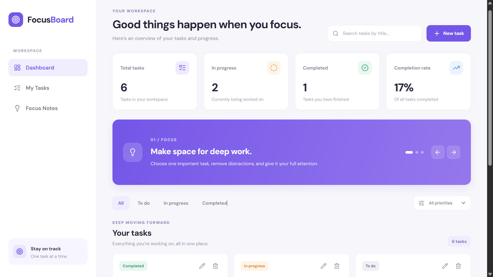

# FocusBoard – Task Management Dashboard

FocusBoard is a responsive task management dashboard built with React. It helps users organize daily tasks, track progress, manage priorities, and stay focused.

## Live Demo

[View FocusBoard Live](https://focusboard-mu-gilt.vercel.app/)

## GitHub Repository

[View Source Code](https://github.com/venukaringula/Focusboard)

## Features

- **Dashboard:** View task statistics, including total tasks, tasks in progress, completed tasks, and completion percentage.
- **Task Management:** Create, edit, and delete tasks.
- **Task Status:** Organize tasks into To Do, In Progress, and Completed.
- **Priority Management:** Assign priorities to tasks.
- **Search:** Search tasks by title.
- **Filtering:** Filter tasks by status and priority.
- **Focus Notes:** Browse focus tips using a manual carousel.
- **Local Storage:** Save tasks in the browser so they remain available after refreshing the page.
- **Responsive Design:** Layout adapts to desktop, tablet, and mobile screens.

## Technologies Used

- React
- JavaScript
- HTML5
- CSS3
- Vite
- Lucide React
- Browser Local Storage

## Getting Started

Follow these steps to run the project locally.

### 1. Clone the repository

```bash
git clone https://github.com/venukaringula/Focusboard.git
```

### 2. Navigate to the project folder

```bash
cd Focusboard
```

### 3. Install dependencies

```bash
npm install
```

### 4. Start the development server

```bash
npm run dev
```

Open the local URL displayed in your terminal.

### 5. Build for production

```bash
npm run build
```

## State Management

FocusBoard uses React state to manage tasks, search input, filters, and the task form.

The `useLocalStorage` custom hook stores and retrieves task data from the browser's Local Storage.

- Tasks are loaded from Local Storage when the application starts.
- New tasks are saved automatically.
- Editing and deleting tasks update the stored data.
- Existing saved tasks are preserved when the page is refreshed.

## Project Structure

```text
focusboard/
├── public/
├── src/
│   ├── components/
│   ├── data/
│   ├── hooks/
│   ├── App.jsx
│   ├── App.css
│   ├── index.css
│   └── main.jsx
├── index.html
├── package.json
└── README.md
```

## Screenshots

### Desktop View



### Mobile View


## Deployment

The application is deployed using Vercel.

**Live URL:** https://focusboard-mu-gilt.vercel.app/

## Author

**Venu Karingula**

- GitHub: [venukaringula](https://github.com/venukaringula)
- LinkedIn: [Venu Karingula](https://linkedin.com/in/venu-karingula-a96112371)
